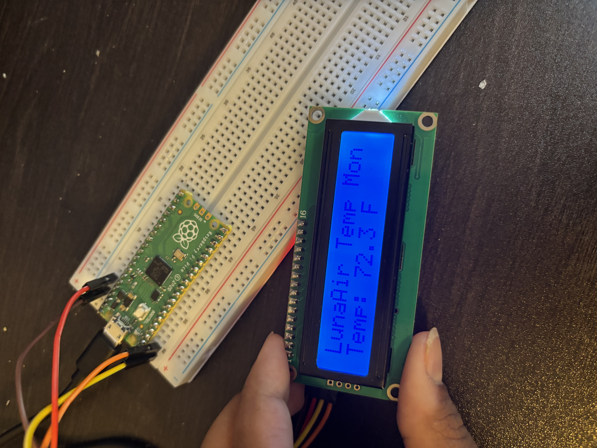
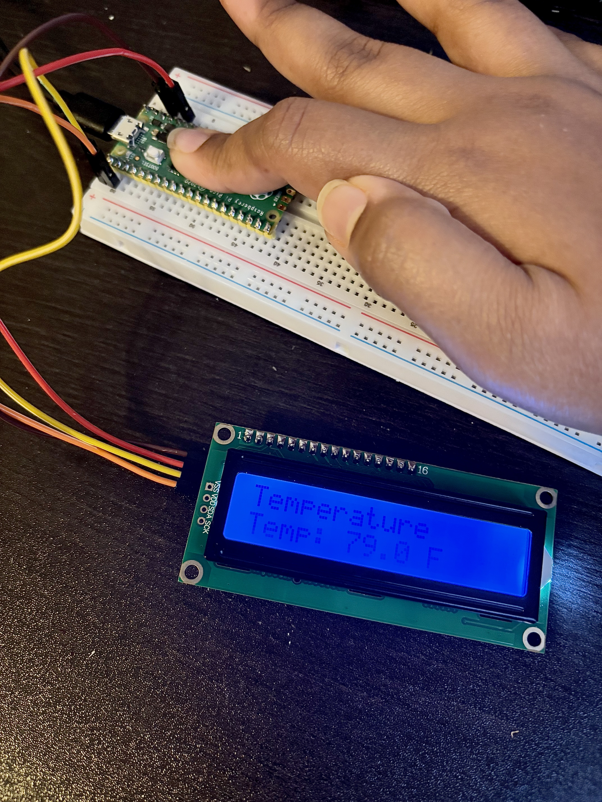

# Temperature Monitoring

This module is responsible for monitoring temperature
conditions around Luna's living space.

## Prototype History

### Prototype 1 — Pico Internal Temperature Sensor
Status: Complete

- Used the Pico's internal temperature sensor
- Converted readings to Fahrenheit
- Displayed readings on a 16x2 I2C LCD

### Prototype Photos

### Prototype 2 — Temperature Alerts
Status: Planned

- Measure actual ambient temperature
- Improve measurement accuracy
- Define temperature thresholds
- Trigger alerts when thresholds are exceeded
